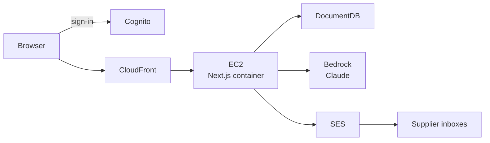

# Architecture — Agri-Supply Agent

Agri-Supply Agent helps a farm or agri-business describe a needed service, find ranked suppliers and products from our database, and draft outreach emails that a human must approve before send.

All AWS resources for this architecture are defined as CDK stacks in `infra/` (nothing is built by hand in the console except the one-time steps in `docs/deploy.md`).

## System diagram

## User flow

1. The user creates a **buyer profile** (company name, address/state, delivery target date, service needed).
2. The user tells the agent something like **“we need X service.”**
3. The app browses **companies by service** and the agent **ranks** them, asking follow-up questions if details are missing.
4. The user **picks companies and products**.
5. The agent **drafts one email per company**.
6. The user **edits each draft inline and approves** it.
7. The app **sends** each approved email and **records** it in the database.

## Data model (high level)

| Collection / type | Meaning |
| --- | --- |
| **BuyerProfile** | The farm or agri-business using the app: who they are, where they are, and what they typically need. |
| **Company** | A supplier company in our catalog that can fulfill services or sell products. |
| **Product** | A specific product or offering tied to a supplier company. |
| **ServiceRequest** | One ask from a buyer (“we need X by this date”) that the agent works against. |
| **Match** | A ranked link between a service request and a suggested company/product. |
| **EmailDraft** | A drafted (and later approved/sent) outreach email to one company, including approval state. |
| **AgentRun** | A recorded agent conversation/run: inputs, tool use, and suggestions for auditability. |
